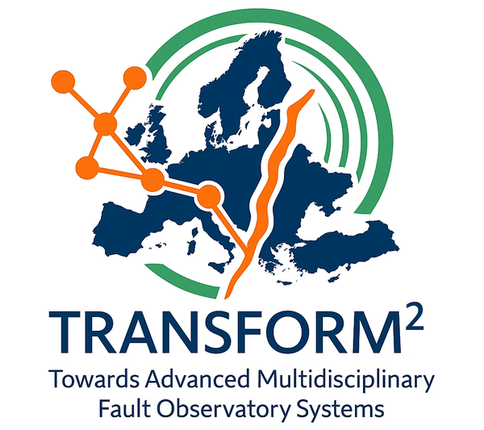

# Gisola-BaBoo User Manual

## Overview

Gisola-BaBoo (Velentzas et al., 2026) is an open-source software for the automatic computation of earthquake moment tensors, with an estimate of the uncertainty of each solution. It is based on two earlier works: Gisola (Triantafyllis et al., 2021), an application for real-time moment tensor inversion that provides the workflow from the selection of the event, the stations and the data to the results and the web pages, and ISOLA-BaBoo (Zahradník et al., 2026), a code for moment tensor inversion with uncertainty estimation by a Bayesian bootstrap. Gisola-BaBoo brings the Bayesian bootstrap into the Gisola workflow, with a new implementation of the inversion in Python and Numba that runs on the CPU or on an NVIDIA GPU.

It automates the estimation of the centroid moment tensor of an earthquake, from the earthquake notification to the published solution. It can run in two modes. In real-time mode, it monitors an event server (e.g. SeisComP) and automatically computes a moment tensor for every earthquake that meets the configured criteria. In batch mode, it reprocesses historical events from archived data.

For every event, the workflow is the same:

1. **Input:** the event (origin time, location and magnitude), the metadata of the stations around it and their waveforms are retrieved (Input Handling).
2. **Station and signal selection:** stations at suitable distances are chosen, recordings with problems are removed, and the remaining stations are selected so that they cover all directions around the epicenter (Station and Signal Selection).
3. **Green's functions:** the synthetic seismograms of elementary sources on a grid around the catalog location are computed (AXITRA), using a regional velocity model (Computation Configuration).
4. **Inversion:** for every trial source and time shift, the moment tensor that best fits the recordings is estimated (the ISOLA method), and the best fit gives the solution (Computation Configuration).
5. **Uncertainty:** a Bayesian bootstrap repeats the inversion with random station weights to estimate how reliable the solution is (Computation Configuration).
6. **Results:** the solution is published as QuakeML, text files, figures and web pages, and optionally sent by e-mail (Outputs).

All steps are controlled by a single configuration file, which holds the seismological knowledge as rules. Some rules depend on the magnitude of the event: they set the station distances, the grid of trial sources, the length of the waveform window, the frequency band and the time-shift search. Others depend on its location: they choose the crustal model and whether a full or a deviatoric moment tensor is computed. For each event, Gisola-BaBoo selects the rules that match it and applies them automatically. How to run the program is described in Usage.

## Installation

Gisola-BaBoo runs on Linux, or on Windows through WSL. It needs conda (for Python and the packages) and `gfortran` and `make` (to compile AXITRA, the Green's function program). An NVIDIA GPU can be used as well, if you have one. No administrator rights are needed.

### Automatic installation

```
git clone https://github.com/VasilisVel/Gisola-BaBoo.git ~/Gisola-BaBoo
cd ~/Gisola-BaBoo
bash install.sh
```

The script checks what is missing and asks before it downloads anything (the default answer is no; `--yes` answers yes to all, `--no-gpu` skips the GPU check). It does these steps:

1. **conda:** it looks for conda, and can install Miniforge.
2. **Environment:** it creates the conda environment `GisolaBaBoo` from `environment.yml`. To build it again, run `conda env remove -n GisolaBaBoo` and then `bash install.sh`.
3. **gfortran and make:** it looks for them, and can install them into the environment.
4. **AXITRA:** it compiles it.
5. **GPU:** with an NVIDIA GPU, it tests it and tries to set it up (see GPU support).
6. **Numba kernels:** it runs `precompile.py`.
7. **Stack limit:** it adds `ulimit -s unlimited` to `~/.bashrc`.

Open a new terminal afterwards.

### Manual installation

```
curl -L -O https://github.com/conda-forge/miniforge/releases/latest/download/Miniforge3-Linux-$(uname -m).sh
bash Miniforge3-Linux-$(uname -m).sh            # conda; then open a new terminal
cd ~/Gisola-BaBoo
conda env create -f environment.yml
conda activate GisolaBaBoo
conda install -c conda-forge --override-channels gfortran make    # if missing
(cd src/core/green && make)                      # compile AXITRA
(cd src && python precompile.py)                 # pre-compile the Numba kernels
```

### Testing the installation

Two examples (the calls are analyzed in Usage):

```
conda activate GisolaBaBoo
cd ~/Gisola-BaBoo/src

# 1. Local run of the benchmark event: it uses local data, so it runs with a different configuration.
python GisolaBaBoo.py -c ../test/config.yaml --event-xml ../test/benchmark/event.xml

# 2. Run that communicates with the server to get 10 events of 2013: it runs with the default configuration.
python GisolaBaBoo.py --event-file ../test/greece2013_events.txt
```

The first call needs no network, and takes about 1 minute (Mw 7.0, variance reduction 79.6 %). The test configuration has a fixed seed (`RandomSeed: 42`), so the benchmark gives the same results on every run. The second call downloads 10 events, and takes 5 to 15 minutes. The results go to `test/results/` and `output/`.

### GPU support (if you have an NVIDIA GPU)

Gisola-BaBoo can run on an NVIDIA GPU (`ComputeDevice: GPU` in the configuration file). By default it uses the CPU, and then nothing in this section is needed. The GPU code was tested on one GPU, the CPU is often as fast on consumer GPUs, and AMD and Intel GPUs are not supported.

**What the installer does.** If the computer has an NVIDIA GPU, `install.sh` tests it with a small program (`check_gpu.py`). If the test fails (the CUDA libraries are missing, or the driver is newer than the Numba version supports), the installer asks your permission and installs `numba-cuda`, the NVIDIA package that brings the CUDA libraries, into the environment (about 600 MB). It uses the variant for CUDA 12 or for CUDA 13, as your driver supports. At the end it prints `GPU: ready`, or the reason why the GPU cannot be used; then the program runs on the CPU. If the GPU still cannot be used after the install, the message also gives the command that removes the installed packages. The NVIDIA driver is part of the operating system, so the installer never installs it.

**If the automatic set-up failed, set up the GPU yourself.** The libraries have to fit your GPU and your driver. By hand:

1. **The driver.** Run `nvidia-smi`. It shows the driver and the highest CUDA version that the driver supports (`CUDA Version`). If the command is not found, there is no NVIDIA driver: install it first (in WSL, the driver is installed on Windows).
2. **The GPU.** Run `nvidia-smi --query-gpu=name,compute_cap --format=csv`. It shows the name and the generation of your GPU. A newer GPU needs a newer CUDA version. NVIDIA's documentation (https://developer.nvidia.com/cuda-gpus) shows what your GPU needs.
3. **The libraries.** Install numba-cuda, the NVIDIA package that brings the CUDA libraries, in the variant of your driver: `cu12` for a driver that supports CUDA 12.x, `cu13` for CUDA 13.x. The first command updates `pip`, which is too old for numba-cuda:

```
python -m pip install -U "pip<25"
python -m pip install "numba-cuda[cu12]==0.20.1"
```

4. **The check.** Run `python check_gpu.py` in the `src` folder. It runs a small kernel on the GPU, and prints `GPU works`, or the reason why it does not.
5. **Switch it on.** Set `ComputeDevice: GPU` in the configuration file. In the `src` folder delete `__pycache__` and `modules/__pycache__` (kernels saved before cannot be read by numba-cuda), and run `python precompile.py` again.

### Pre-compiled kernels

Numba compiles the heavy functions the first time they run, and saves them in `src/__pycache__`. The program `precompile.py` does it in advance (about 20 s); it is not required. Run it again after any change to `src/IsolaPy.py` (even saving it again; the same for `src/modules/clip.py` and `src/modules/mouse2.py`), after setting up the GPU, and on another computer.

## Input Handling

Gisola-BaBoo needs three inputs for every event:

- **Event:** the earthquake to process, with its origin time, location, depth and magnitude.
- **Station metadata:** where the stations are and what instruments they have (sensor type, orientation and instrument response).
- **Waveforms:** the ground-motion recordings of those stations.

Each input can come from a public data center, an institutional server or local files. FDSNWS is the standard web service of seismological data centers; it has one service per input: fdsnws-event for events, fdsnws-station for station metadata and fdsnws-dataselect for waveforms. In the configuration, FDSNWS entries only need the address of the server, and Gisola-BaBoo uses the right service for each input. Which sources are used depends on how Gisola-BaBoo is run:

| Input | Real time | Historical events |
|---|---|---|
| Event | the network's FDSNWS-event server (e.g. SeisComP), which publishes new events with the lowest delay | any FDSNWS-event server with the catalog for the period (e.g. a public one such as EMSC, USGS or EIDA), a QuakeML file or the command line |
| Station metadata | an FDSNWS-station server, or a local StationXML file updated regularly (faster) | an FDSNWS-station server or a local StationXML file |
| Waveforms | SeedLink (lowest delay), with the network's local SDS archive or an FDSNWS-dataselect server for the stations that SeedLink does not provide | an FDSNWS-dataselect server or a local SDS archive |

A local SDS archive (waveforms stored as miniSEED files in the SeisComP Data Structure) can also hold data that are not available online: synthetic signals from simulations, or a copy of the data to rerun the same events with identical inputs, e.g. for benchmarking. Local data need matching station metadata.

### External Data Sources

The three inputs are configured independently.

**Event.Host** is the FDSNWS-event server that provides the origin time, location, depth and magnitude of the events. Only one server can be set, and the choice depends on how Gisola-BaBoo is run:

- **Real time:** use the event server of your network, for example SeisComP's FDSNWS service on the same machine or in the local network. It publishes new events with the lowest delay and does not depend on an external connection.
- **Historical events:** use a public FDSNWS-event server that holds the catalog for the period, such as USGS, EMSC or EIDA, which can provide years of events.

Events can also be given exactly, without any server: either with all their information in a single `-e` call (e.g. `-e 2024-05-15T10:23:01 4.5 ML 37.24 20.49 12.0`) or in a QuakeML file (`--event-xml`). In both cases Event.Host is not contacted.

```yaml
Event:
  Host: http://localhost:8080          # real time: SeisComP fdsnws-event of the network
  # Host: http://eida.gein.noa.gr      # historical runs: public server
```
*Figure 1. Event.Host configuration.*

Figure 1 shows the two usual choices. The first line points to the SeisComP server of the network, here running on the same machine (port 8080), and is used in real time. The second line, commented out, points to a public server (here NOA's) and is used for historical runs. Only one Host line is active at a time: to switch, comment out one line and uncomment the other, or keep two configuration files and choose one with `-c`.

**Inventory.Service** provides the station metadata (locations, sensors, orientations and responses). Two types of source can be listed:

- **FDSNWS** (server address): an FDSNWS-station server, either a public one such as EIDA or the server of your network. The third value is an optional EIDA authentication token, needed only to access restricted data. Give the path to the token file, or `null` to use public data only.
- **StationXML** (file path): a local file with the metadata of the stations, provided by the user. No online query is needed, so it makes this step faster in real time, but the file must be kept up to date.

If several sources are listed, their stations are merged and the first source takes priority. FDSNWS is the usual choice; in real time, a StationXML file is faster.

```yaml
Inventory:
  Service:
    - [FDSNWS, http://eida.gein.noa.gr, null]   # fdsnws-station: usual, online metadata
    # - [StationXML, inventory.xml]             # faster for real time: local file
```
*Figure 2. Inventory.Service configuration.*

**Stream.Service** provides the waveforms. Three types of source can be listed:

- **SeedLink** (`host:port`): the live data stream of the network's SeedLink server (e.g. SeisComP), with the lowest delay. It only keeps a limited buffer of recent data, so it is used for real time.
- **SDS** (folder path): a local archive of miniSEED files in the SeisComP Data Structure.
- **FDSNWS** (server address): an FDSNWS-dataselect server, either a public one such as EIDA or the server of your network.

The sources are tried in the order they are listed, and a station that has already been found is not requested again from the next one. In the example below, SeedLink is asked first because it is the fastest; the local archive and then the public server are used only for stations that SeedLink does not provide. For historical events, list only SDS or FDSNWS.

```yaml
Stream:
  Service:
    - [SeedLink, localhost:18000]              # real time: lowest delay
    - [SDS, /path/to/sds/archive]              # local archive
    - [FDSNWS, http://eida.gein.noa.gr, null]  # fdsnws-dataselect: public server
```
*Figure 3. Stream.Service configuration for real time. For a historical run, remove the SeedLink line.*

### Event Selection (Watcher)

The Watcher is mainly used in real time. The event server publishes each earthquake several times: first a quick automatic origin, then better ones, and finally often a manual one from an analyst. Gisola-BaBoo is started every minute by cron; each call asks Event.Host for recent events, and the Watcher decides, for each one, whether to run it and which hypocenter (origin) to use. An event that already has a folder in WorkDir is skipped, so it is not computed twice. For a datetime range (`-d`), only Magnitudetype, the minimum magnitude and Historical apply.

```yaml
Watcher:
  Magnitudetype: MLh                   # null = any magnitude type
  Range: 60
  Playback: 0                          # 0 = real time
  Historical: false
  Geobox: (20.3054,37.2037), (22.4079,33.6323), ...   # (longitude, latitude)
  Quality:
    Time: 1                            # s
    Depth: 10                          # km
    Latitude: 15
    Longitude: 15
    Magnitude: 0.3
    Timeout: 120                       # s
```
*Figure 4. Watcher settings of the NOA real-time system (Geobox shortened).*

**Which events are processed**

- **Magnitudetype:** only events that have a magnitude of this type are requested (e.g. MLh); `null` = any type. The minimum magnitude is not set here: it is the lowest magnitude of the Inversion.Window rules. Not used for single events given by ID (`-e`).
- **Geobox:** only events inside this polygon are processed; points are (longitude, latitude). Draw it around the region your stations cover well. `null` = no limit.

**Which hypocenter is accepted**

- **Quality:** the limits an origin must meet to be considered good: Time (origin time uncertainty, s), Depth (depth uncertainty, km; it must be reported, not 0), Latitude and Longitude (location uncertainties as given by the event server) and Magnitude (magnitude uncertainty). Manual origins always pass.
- **Timeout:** for this many seconds after the waveforms of an event are complete, any origin is accepted, so that every event gets a fast solution. After that, only a manual origin or one within the Quality limits is accepted.
- **Range:** how long an event stays in the search. An event that is not accepted yet is checked again at the next calls, and a larger Range keeps it in the search for longer. This catches events that the server publishes late, or that were missed while Gisola-BaBoo was stopped, and gives more time for a good origin to appear.

**Simulating real time (extra)**

These two settings are used to test a real-time setup on past events, or to know what real time would have produced.

- **Playback:** shifts "now" back by this many seconds, so that Gisola-BaBoo behaves as if it were an earlier time and replays past events as if they were happening (`0` = true real time).
- **Historical:** which origin of an event is used, in every mode. `false`: the preferred origin (or the latest one), usually the best. `true`: the first origin that would have been accepted, as a real-time system would have used it. For a true replay, use both: Playback sets the clock and Historical `true` reproduces the origin of that moment.

## Station and Signal Selection

Before the inversion, Gisola-BaBoo decides which stations and which recordings to use. This choice strongly affects the quality of the solution: the stations should be at suitable distances for the event's size, surround the epicenter as evenly as possible, and provide clean, reliable recordings.

The selection is automatic and runs as a sequence of steps, always in the same order for every event. It starts with all stations within the possible distance range and narrows them down step by step:

1. **Retrieve the event:** origin time, location and magnitude, which select the rules for the following steps.
2. **Retrieve the station metadata** of the stations and channel types allowed by the distance rules.
3. **Download the waveforms** for these stations.
4. **Quality checks:** remove recordings with gaps, saturation or disturbances, and correct for the instrument response.
5. **Azimuthal selection:** keep the best stations in each direction around the epicenter, so the coverage is as even as possible.

All these steps are set by the user in the configuration file. Every decision to keep or remove a station or a recording is saved in the log file of the event, so the user can check how the station set was reduced.

### Step 1 — Retrieve the event

The origin time, epicenter, depth and magnitude are read from Event.Host, or taken directly from the command line or a QuakeML file, in which case no server is contacted. The magnitude selects the rules, the epicenter is the origin of the coordinate system for the station search (distances and azimuths are measured from it), and the origin time defines where the inversion window starts.

### Step 2 — Retrieve the station metadata

The station metadata (locations, sensors and responses) are requested from Inventory.Service, only for the stations that can be used for this event.

The distance rules are defined by the user in Inventory.Distance, separately for each magnitude range, as in Figure 5: each rule gives the magnitude range (minMag, maxMag), the minimum and maximum epicentral distance in km (minDist, maxDist) and the accepted channel types (channel codes). The stations must be far enough (the minimum distance) for the source to look like a single point that releases its energy instantaneously, which is the model used in the inversion. A larger event has a larger rupture, so its stations must be farther. The distances therefore grow with magnitude.

```yaml
Inventory:
  Distance:
    - [3.5, 4.0, [5, 150, ['BH','HH']]]
    - [4.0, 5.0, [10, 250, ['BH','HH']]]
    - [5.1, 5.5, [40, 300, ['BH','HH']]]
    - [5.1, 5.5, [20, 100, ['HN','EN']]]
    - [5.6, 6.0, [20, 450, ['BH','HH']]]
    - [5.6, 6.0, [20, 150, ['HN','EN']]]
    - [6.1, 9.0, [100, 700, ['BH','HH']]]
  Components: ['Z23', 'Z12', '123', 'ZNE']
```
*Figure 5. Distance rules [minMag, maxMag, [minDist_km, maxDist_km, [channel codes]]] and accepted orientation sets.*

The metadata request asks only for the channel types of matching rules, over their overall distance range, so unwanted channels are not downloaded. **Components** list the accepted orientation sets, which are later rotated to Z, N, E (based on the information in the metadata).

The station file (Inventory.WhiteList.Filepath) allows the network operator, who has the best understanding of the network, to encode this knowledge as a priority assigned to each station. It has one station per line, as `NET STA priority`, as in Figure 6.

```
# NET  STA   priority
CQ     AKMS  5
CQ     LEF1  4
CQ     NATA  3
CL     MALA  2
CL     AGEO  1
CL     TEME  0
```
*Figure 6. Lines of the station file: network, station and priority.*

- **0** blacklists the station: it is never used.
- **Positive values** rank the stations: a higher value means a more trusted station. The priorities decide which stations are kept when several compete (Step 5), and the rules below use them to keep only the best stations for larger events.

A station with no priority in the file, or not listed at all, gets the default value Priority. `*` can stand for all the stations of a network (e.g. `HL * 0`).

The file, the default Priority and the rules that use the priorities are set in the configuration, as in Figure 7:

```yaml
Inventory:
  WhiteList:
    Filepath: ./stationsChr
    Priority: 2
    Rules:
      - [3.0, 3.9, 2]
      - [4.0, 4.5, 3]
      - [4.6, 5.0, 3]
      - [5.1, 5.8, 4]
      - [5.9, 9.0, 5]
```
*Figure 7. Station file and priority rules [minMag, maxMag, magPriority].*

Rules set a minimum priority, magPriority, for each magnitude range:

- If magPriority is greater than Priority, only stations in the file with a priority of at least magPriority are used.
- Otherwise, all stations are used except the blacklisted ones.

The bound always comes from the rule; Priority only decides whether the rule filters. A high Priority therefore switches the filtering off for the rules at or below it.

With the rules above (Priority 2), events of Mw 3.0–3.9 use every station, and larger events use only stations with priority 3, 4 or 5 and above, respectively. The rules must cover every magnitude that is processed.

The priorities are also used to rank the stations in Step 5: when there is room for only some stations, those with a higher priority are kept. Stations that are not in the file are ranked with the default Priority.

If `Filepath` is `null`, no priorities are given: all the stations of the metadata are candidates with the same priority, and the rules above are not applied.

### Step 3 — Download the waveforms

Waveforms are requested only for the stations that pass Step 2. The requested data start 10 seconds before the origin time and end at the end of the inversion window of the event (the longest one, if several Window rules match its magnitude; see Waveform window in Inversion Parameters). One extra hour of pre-event noise is added when the ppsd module is active. Traces that do not cover this whole period are discarded.

### Step 4 — Quality checks and instrument correction

First, traces with gaps or with data that are inconsistent with the metadata are removed, and the components are rotated to Z, N, E if needed, according to the metadata. Then the checks listed in Stream.Modules run on each trace; a trace that fails a check is discarded.

```yaml
Stream:
  Modules: ['clip', 'mouse', 'ppsdoffline']
  MouseAlgorithm: 1           # 1 = Vackář 2015 (default), 2 = Zahradník 2026 (new)
```
*Figure 8. Signal quality modules.*

| Module | What it checks |
|---|---|
| `clip` | saturation of broadband records (Wang & Zhang 2020): local extrema within 98 % of the trace peak |
| `snr` | signal-to-noise ratio below the minimum |
| `ppsd` | the power spectral density of one hour of pre-event noise, compared with a noise model |
| `ppsdoffline` | the same, using PSD results computed beforehand by tools/ppsd_app/ppsd_app.py, which must run regularly (e.g. daily by cron); a trace without a result file is rejected. Faster in real time. |
| `mouse` | long-period disturbances ("mouse") in broadband records, detected by one of two algorithms, chosen by the user with MouseAlgorithm: 1 (Vackář 2015, default) or 2 (new, Zahradník 2026) |

For real time, ppsdoffline is faster than ppsd, which needs one hour of pre-event data; an empty list [] runs no checks.

With ppsd or ppsdoffline, a station whose vertical component is the only one that passes is dropped. After the checks, the instrument response is removed (ground velocity in m/s, pre-filter 0.001–9 Hz); an instrument with incomplete metadata is dropped with a warning.

### Step 5 — Azimuthal selection

The stations should surround the epicenter as uniformly as possible, without concentration in some direction or gaps in others. For this, the 360° around the epicenter are divided into 8 sectors of 45°, and up to the same number of the best stations are taken from each sector. In each sector, the stations are ranked by priority (from the station file), sensor type (velocity before acceleration), number of components and distance (closer first), and the best ones are kept.

```yaml
Inventory:
  Azimuth: [3, 2]
```
*Figure 9. Azimuth: [minimum populated sectors, maximum stations per sector (null = no limit)].*

Azimuth has two values:

- **Minimum populated sectors (first value):** the number of sectors that must contain at least one station. If fewer sectors have a station, the event is stopped and not processed, because the azimuthal coverage is too poor for a reliable inversion. With 3, at least 3 of the 8 sectors must be covered.
- **Maximum stations per sector (second value):** each sector keeps at most these many of its best stations. With 2 stations and 8 sectors, up to 16 stations are used. With `null`, all the stations of each sector are kept, and only Green.MaxStations limits the total.

## Computation Configuration

This part describes the parameters that the user sets for all the computations that lead to the moment tensor, in three stages. Most of them are rules that depend on the magnitude or the location of the event, and Gisola-BaBoo applies the ones that match each event.

1. **Green's functions:** synthetic seismograms of elementary sources are computed for a grid of trial sources around the hypocenter, using a 1D velocity model chosen for the region of the event.
2. **Inversion:** the recorded waveforms are filtered in a frequency band and cut in a time window. For each trial source and time shift, the moment tensor that best fits them is estimated, and the best fit gives the solution.
3. **Bayesian bootstrap:** the inversion is repeated many times with random station weights, to estimate how reliable the solution is.

The size of the grid, the number of stations and the length of the windows determine the computation time and the memory needed.

### Green's Functions

#### Regional velocity models

The Green's functions depend on the velocity structure of the Earth between the source and the stations, which differs from one region to another. The user therefore provides one or more 1D velocity models (crustal models) and links each of them to the region where it is valid, defined as a Geobox. Every model whose region contains the epicenter is used; if several match, the event is inverted with each model, and the best-fitting solution is kept. The entry with Geobox: null is the default: it is used only when no region contains the epicenter. In this way each event is modelled with the most appropriate structure.

```yaml
Green:
  Crustal:
    - Filepath: crustals/drakatos.vz
      Geobox: (22.6163,37.6465), (23.3432,36.8208), ...
    - Filepath: crustals/santorini.vz
      Geobox: (25.1,36.2), (25.7,36.2), (25.7,36.6), (25.1,36.6), (25.1,36.2)
    - Filepath: crustals/novotny.vz
      Geobox: null
```
*Figure 10. Regional crustal models (3 of the 6 models shown). Geobox points are (longitude, latitude).*

#### Source grid

The centroid is searched on a grid of trial sources around the hypocenter, which the user defines separately for each magnitude range (Rule), as in Figure 11. Distance gives the horizontal offsets from the epicenter and Depth the vertical offsets from the hypocenter depth, each as [min, max, step] in km. The offsets are applied in both directions (east–west and north–south use the same values, and depths above and below the hypocenter depth); the max value itself is not included, so [0, 9, 2] gives 0, ±2, ±4, ±6 and ±8 km. Trial depths shallower than 1 km are skipped. A rule can list several ranges, for example a small step near the epicenter and a larger step farther away, to cover a wide area with fewer trial sources. The grid grows with magnitude, because the centroid of a large event can be far from its hypocenter. The grid size drives the computation time and memory.

```yaml
Green:
  Grid:
    - Rule: [4.0, 5.5]
      Distance:
        - [0, 9, 2]
      Depth:
        - [0, 31, 2]
    - Rule: [5.6, 6.5]
      Distance:
        - [0, 9, 4]
        - [15, 21, 5]
      Depth:
        - [0, 31, 2]
    - Rule: [6.6, 9.0]
      Distance:
        - [0, 31, 5]
      Depth:
        - [0, 31, 2]
```
*Figure 11. Source grid rules; Distance and Depth are [min, max, step] offsets in km.*

```yaml
Green:
  MaxStations: 16
  MaxSources: 1000
```
*Figure 12. Station limit and size of the groups of grid points.*

MaxStations is the maximum number of stations used in the inversion; the lowest-ranked stations are removed if there are more, for example when Azimuth has `null`. The grid points (trial sources) are given to AXITRA in groups, and MaxSources is the number of grid points in each group. The default of 1000 was chosen by fine tuning on test runs.

#### Frequency content

AXITRA computes the Green's functions one frequency at a time, so the computation time grows with the number of frequencies. A window of 1024 samples has 513 frequencies, but only those up to the upper corner of the inversion band (fmax) matter, because the band-pass filter removes the rest. Gisola-BaBoo therefore computes frequencies only up to FreqMultiplier × fmax. The margin above fmax is needed because the filter does not cut sharply.

```yaml
Green:
  FreqMultiplier: 2.5
  NyquistSamples: null     # 513 = full spectrum
```
*Figure 13. Frequency content of the Green's functions.*

NyquistSamples, if set, gives the number of frequencies directly and overrides FreqMultiplier. A value of 513 computes the full spectrum: the slowest choice, useful for offline work and benchmarks. For normal and real-time use, keep it null.

### Inversion Parameters

The rules below are selected by magnitude. A magnitude range includes both of its limits, so to avoid one magnitude matching two rules, start the next range one decimal higher (for example, [3.0, 3.8] followed by [3.9, 4.5]). When several rules of any type match an event (frequency, window, time shift, source grid or crustal model), every combination is inverted and the one with the highest variance reduction is kept. This can be used on purpose to test alternatives, but it multiplies the computation time.

#### Frequency band

The recorded waveforms and the synthetic seismograms are filtered in the same way, with a band-pass filter [fmin, fmax] in Hz. Only low frequencies are kept, because their long wavelengths are much less affected by the differences between the real Earth and a simplified 1D velocity model: the effect of the model errors scales with the ratio of the epicentral distance to the wavelength. The lower limit fmin excludes the long-period noise. The band moves to lower frequencies as the magnitude grows. A larger earthquake has a longer rupture, so only longer periods can be treated as a point source with an instantaneous release. The stations of a larger earthquake are also farther away, so the maximum frequency must be lower to keep the distance-to-wavelength ratio small.

```yaml
Inversion:
  Frequency:
    - [3.0, 5.4, [0.04, 0.09]]
    - [5.5, 5.9, [0.02, 0.07]]
    - [6.0, 7.0, [0.01, 0.06]]
    - [7.1, 9.0, [0.007, 0.03]]
```
*Figure 14. Frequency rules [minMag, maxMag, [fmin, fmax]].*

The band is checked before the Green's functions computation: it must satisfy 0 ≤ fmin < fmax < fNyquist, the Nyquist frequency of the window, otherwise processing of the event stops with a clear message. If fmin is set to 0, the lowest frequency of the window (1/window) is used instead, as in ISOLA, because the band-pass filter needs a lower corner above 0 Hz.

#### Waveform window

The window starts at the origin time and is the same for all stations, for both the data and the synthetics, so the waves of near stations appear early in the trace and those of far stations later. It should be long enough to contain the surface waves at the farthest station and several cycles of the longest period of the frequency band (1/fmin). Larger events therefore use longer windows, because their stations are farther away and they are inverted at lower frequencies. The window is always sampled with 1024 points, so the time step is Dt = window / 1024 and the Nyquist frequency is fNyquist = 512 / window. Multiples of 102.4 s give Dt in steps of 0.1 s.

```yaml
Inversion:
  Window:
    - [3.0, 3.4, 102.4]
    - [3.5, 3.8, 102.4]
    - [3.9, 4.5, 204.8]
    - [4.6, 5.5, 307.2]
    - [5.6, 7.1, 409.6]
    - [7.2, 9.0, 1024]
```
*Figure 15. Window rules [minMag, maxMag, seconds].*

#### Centroid time search

The centroid time is searched around the origin time as [start, step, end], in samples of Dt (both ends included; for example, [-5, 1, 16] with Dt = 0.3 s covers −1.5 s to +4.8 s in steps of 0.3 s); negative values are before the origin time. The synthetics are shifted in time by each trial value, and the best-fitting shift is kept. Every trial source is tested at every time shift, so the search time grows with both.

```yaml
Inversion:
  TimeShift:
    - [3.0, 4.5, [-10, 1, 20]]
    - [4.6, 5.5, [-5, 1, 16]]
    - [5.6, 9.0, [-5, 2, 43]]
```
*Figure 16. TimeShift rules [minMag, maxMag, [start, step, end]] in Dt units.*

#### Source time function

```yaml
Inversion:
  STF:
    type: delta        # or triangle
    duration: 5.0      # triangle half-duration (s)
```
*Figure 17. Source time function.*

The source time function describes how the seismic moment is released in time. delta (the default) releases it instantaneously, which is adequate while the rupture is short compared with the periods used. triangle spreads it over a symmetric triangle of half-duration duration seconds (total length 2 × duration), and suits large events whose rupture lasts a significant part of a period. Unlike the rules above, this setting does not depend on the magnitude: it applies to all the events of the run.

#### Deviatoric and full moment tensor

By default, Gisola-BaBoo computes a deviatoric moment tensor, which assumes no volume change at the source (5 independent components, a double-couple and a CLVD part). This suits tectonic earthquakes, which are shear faulting, and gives more stable results because fewer parameters are estimated. In areas where volume changes are possible, such as volcanic or geothermal regions, the full moment tensor (6 components, including the isotropic part) can be computed instead. The user lists these areas as Geoboxes in IsotropicGeoboxes: events inside one of them get a full moment tensor, all others a deviatoric one. Keyinv overrides the areas and forces the same choice for every event (1 = full, 2 = deviatoric).

```yaml
Inversion:
  Keyinv: null         # 1 = full, 2 = deviatoric; null = use IsotropicGeoboxes
  IsotropicGeoboxes:
    # Santorini, Amorgos
    - (36.158758, 25.404119), (36.426637, 25.140630), (37.042126, 26.028408),
      (36.808750, 26.269440), (36.158758, 25.404119)
```
*Figure 18. Full moment tensor areas. Note: points are (latitude, longitude) here, unlike Green.Crustal.*

### Bayesian Bootstrap

The Bayesian bootstrap is used to characterize the solution statistically (Zahradník et al. 2026). The inversion is repeated Iterations times (default 100), each time with a different random set of station weights drawn from a Dirichlet distribution. The weights adjust the relative importance of the stations, and all components of a station share the same weight. In each repetition, the best-fitting solutions (NBEST) are retained.

```yaml
Bootstrap:
  Enabled: true
  Iterations: 100       # number of random sets of station weights
  KeepFraction: 0.02    # NBEST: fraction of (point, shift) pairs
  CentroidBoxVR: 0.7    # points with VR >= 0.7 x VRmax; null = off
  CentroidBox: null     # rules [Mmin, Mmax, Dx, Dy, Dz] km
  #  - [0.0,  5.5,  6,  6, 8]
  #  - [5.6,  6.5, 12, 12, 8]
  #  - [6.6,  9.0, 15, 15, 8]
```
*Figure 19. Bootstrap configuration.*

| Key | Meaning |
|---|---|
| Enabled | true / false. When false, only the best solution is reported. |
| Iterations | number of bootstrap iterations, each with its own random set of station weights (default 100). |
| KeepFraction | NBEST, the number of best (grid point, time shift) pairs kept in each repetition, as a fraction of all pairs in the centroid box (0.02 in the example, 0.1 if the key is missing). With 0, only the single best pair is kept in each repetition, as in the original Bayesian bootstrap. A positive fraction also keeps near-optimal pairs, which gives a smoother ensemble with wider intervals, as in ISOLA-BaBoo (Zahradník et al. 2026). A grid point can enter several times with different time shifts. |
| CentroidBoxVR | the grid points searched: the bounding box (in X, Y and Z) of all grid points whose best VR is at least this fraction of VRmax, 0 < value ≤ 1. Larger values give a smaller box; 1.0 keeps only the best point. |
| CentroidBox | optional rules [Mmin, Mmax, Dx, Dy, Dz]: a box of ±Dx, ±Dy, ±Dz km around the best centroid, moved inside the grid at its edges. This rule overrides CentroidBoxVR for the magnitudes it covers, so set CentroidBox to null to use CentroidBoxVR. |

The user controls the bootstrap through three settings:

- **Iterations:** the number of bootstrap iterations, that is, the number of inversions that are run, each with its own random set of station weights.
- **Search region:** the bootstrap can be restricted to a subgrid to make it faster, either with the bounding box of the grid points whose VR is at least CentroidBoxVR × VRmax, or with a box of ±Dx, ±Dy, ±Dz km around the best centroid, defined by the user for each magnitude range (CentroidBox, which takes precedence where it applies). If both are null, the bootstrap runs on the whole grid. The box limits only the space: every repetition searches all the time shifts.
- **Accepted solutions (KeepFraction):** NBEST is derived from the fraction as NBEST = KeepFraction × (number of grid points in the search region × number of time shifts), rounded down and at least 1. With 0, NBEST = 1: only the best solution of each repetition is kept, as in the original, strict Bayesian bootstrap. A positive fraction also keeps near-optimal solutions, which gives a smoother ensemble with wider intervals, as in ISOLA-BaBoo.

The result is an ensemble of NBEST × Iterations solutions. From it, Gisola-BaBoo computes the median moment tensor, with its nodal planes, M0 and Mw, and the median values and the 68 % and 95 % confidence intervals of the tensor components, M0, Mw, DC, CLVD, ISO, the centroid position and the centroid time.

## Outputs

All results are written below the folder given by WorkDir: the folder of every run, and the catalog web pages. A relative path is taken from the folder Gisola-BaBoo is started from (normally src/, as in the cron example in Usage).

```yaml
WorkDir: ../results        # root of all event folders and web pages
```
*Figure 20. Root folder of all results.*

Each run gets its own folder, WorkDir/YEAR/EVENT_ID/TIMESTAMP/, so a new run of the same event never overwrites an earlier one:

```
results/                          WorkDir
├── index.html                    catalog home page
└── 2024/
    ├── index.html                catalog of the year
    ├── list.html, list_all.html
    └── EVENT_ID/
        └── TIMESTAMP/            one folder per run
            ├── output/           results of the best combination
            │   └── plots/        figures
            ├── inversions/       one folder per combination of rules
            ├── allstat/, inpinv/, greens/, raw/, ...
            └── streams_corrected.mseed
```
*Figure 21. Folder structure below WorkDir.*

WorkDir points to the folder where the results are saved. For a revision, it must point to the folder that contains the run of the event.

When several rules match an event (see Inversion Parameters), every combination of rules is inverted, and the combination with the highest variance reduction is the best one. The results of the best combination are in output/, and its figures in output/plots/. Each combination also keeps its own results in inversions/&lt;combination&gt;/, named by the indices of its frequency, time-shift, crustal model, window and grid rules (for example 0.0.0.0.0).

### Result files

| File | Content |
|---|---|
| event.xml | QuakeML: origin, centroid, moment tensor (inversion type "zero trace" or "general"; DC, signed CLVD and signed ISO), nodal planes, quality, stations and components used. |
| event_sc.xml | the same in SeisComP format. |
| mt.txt, emsc.txt | text summaries (mt.txt; EMSC format). |
| solutions, correlations | the best solution at every grid point; the correlation and mechanism for every depth and time shift below the best epicentral position (as ISOLA's corr00.dat). |
| results_inversion.dat | the best solution in text form (VR, moment tensor, planes, M0, Mw, DC/CLVD/ISO, axes). |
| inversion_parameters.dat | all settings used: inversion type, window, band, Green's-function frequencies, time shifts, grid, bootstrap centroid box, crustal model. |
| bootstrap_results.dat | ensemble statistics (median, 68 %, 95 %), the median moment tensor and the computation time of the bootstrap. |
| GraphSearch*.dat | graph-search centroid. |
| event_summary.json | short summary read by the catalog pages. |
| timing_summary.dat | time of each step (the time of each figure is in the log). |
| log | full log of the run (log.revised for a revise). |
| index.html | the event page. |

### Figures

The figures of the best combination are in output/plots/, as PNG files, and are made once per event. After a revision, their names end in .revise (for example beachball.revise.png).

| Figure | What it shows |
|---|---|
| beachball | the focal mechanism of the best solution, with its nodal planes and the P and T axes |
| map | the epicenter with the mechanism, and the stations used |
| streams | the recorded waveforms (ground displacement) of the stations used, for the N, E and Z components; unused components are marked |
| misfit | observed (black) and synthetic (red) waveforms of the best solution for every station and component, with the variance reduction of each trace |
| fit_waveforms | the same observed (blue) and synthetic (orange) waveforms, with all the traces joined in one plot |
| top | a horizontal section of the source grid at the best depth: the mechanism of each grid point, coloured by the correlation, with the best one in red |
| northeast | two vertical sections of the grid through the best position (south–north and west–east), with the mechanism and the correlation at each point |
| time | the mechanisms and their correlation as a function of the centroid time and the depth, at the best horizontal position |
| hist_decomposition | histograms of the double-couple (DC) and CLVD percentages of the bootstrap ensemble |
| hist_iso | the same for the isotropic percentage (ISO); only for a full moment tensor |
| hist_magnitudes | histograms of M0 and Mw of the ensemble |
| hist_centroid_time | histograms of the centroid time and of the X, Y and Z position of the ensemble |
| tradeoff_depth_vr | the ensemble members as CLVD against VR (coloured by depth) and CLVD against depth (coloured by VR), to show the trade-offs between source type, fit and depth |
| tradeoff_depth_vr_iso | the same with ISO instead of CLVD; only for a full moment tensor |
| hudson_median | the ensemble in the Hudson source-type plot, coloured by VR, with the median solution |
| lune_median | the same ensemble in the lune source-type plot (Tape and Tape) |
| beachball_fuzzy | the uncertainty of the mechanism: the shading shows, for each direction, the fraction of ensemble members that have tension (dark) or compression (light) there, with the best (red) and median (green) nodal planes |
| grid_vr_bootstrap | the source grid in map view and in two vertical sections, coloured by VR, with the part used by the bootstrap and the best solution |

In the histograms, the red line is the median, the dashed blue lines are the 68 % interval, the dotted green lines are the 95 % interval and the dashed black line is the best solution.

### Web pages

Gisola-BaBoo builds web pages at three levels, all inside WorkDir:

| Page | Where | What it shows |
|---|---|---|
| Event page | WorkDir/YEAR/EVENT_ID/TIMESTAMP/output/index.html | the solution of one event, with its figures, downloads and bootstrap results |
| Year pages | WorkDir/YEAR/ | the events of one year: index.html is a map, list.html the list of the events with a quality of at least Citation.Quality, and list_all.html the list of all the events |
| Catalog pages | WorkDir/all/ | the same map and lists for all the years together |

WorkDir/index.html forwards to the latest year, so the address of WorkDir is enough to open the catalog.

The event page and the pages of its year are created after each event, and the catalog pages only when you ask for them (see Usage).

### Log

Everything that happens in a run is recorded in its log file, output/log in the run folder (output/log.revised for a revision): the event, the choice of rules and stations, the quality checks, the computations and their times, the warnings and the errors.

## Other Settings

```yaml
ComputeDevice: CPU          # CPU or GPU (falls back to CPU)
MaxCores: null              # null = all available cores
RandomSeed: null            # null = random; a whole number = repeatable results
GraphSearch:
  Enabled: true             # fast centroid search (in development)
Notification:
  Email:
    Smtp: null              # SMTP host; null = no e-mail
    User: user
    Pass: pass
    Sender: sender
    Recipients: recipients
    HostSite: http://localhost/gisola
  Command: null             # e.g. /opt/push.sh $bestinvdir $outputdir
Citation:
  Agency: National Observatory of Athens - Institute of Geodynamics
  Website: http://bbnet.gein.noa.gr
  Quality: B4               # worst quality shown on the web pages
  Logo: web/logo.png
  Author: Gisola-BaBoo
  Version: 1.0
```
*Figure 22. General, notification and citation settings.*

| Key | Meaning |
|---|---|
| ComputeDevice | CPU or GPU (default CPU). With GPU, if no CUDA device is found (or the CUDA libraries cannot be loaded), a message is printed and the run continues on the CPU. |
| MaxCores | the maximum number of CPU cores used by all parallel steps; null uses every available core. |
| RandomSeed | null (default): the random numbers of the clipping check and of the bootstrap differ from run to run, so the result of a borderline event changes slightly (the benchmark gives a variance reduction between 78 and 80 %). A whole number (e.g. 42): the same results on every run on the same computer, also for an event alone or in a list of events. Use it for tests and to compare the CPU with the GPU; the test configuration of the benchmark (`test/config.yaml`) sets 42. |
| GraphSearch | a fast centroid search method (in development). |
| Notification.Email | an e-mail is sent after each solution (normal run and revise) when Smtp is set; a failure gives a warning and the run continues. |
| Notification.Command | a command of your own, run after each solution, for example to send the solution to SeisComP, copy the results to a server or start an alert. $outputdir is replaced by the output folder of the run, and $bestinvdir by the name of the best combination. A failure gives a warning and the run continues. |
| Citation | Agency, Website, Logo, Author and Version are shown on the web pages and in the QuakeML. Quality filters the solutions shown on the web pages: the map and list.html show only the solutions with this quality code or better (A1 is the best, D4 the lowest). |

## Usage

Gisola-BaBoo is run from the command line, and its options control how it is used, from computing specific events and running in real time to revising earlier solutions and rendering the web pages. The default configuration file is `./config.yaml`; another one is given with `-c FILEPATH`.

```
python GisolaBaBoo.py [OPTIONS]
```

The options are grouped by use:

- **Specific events** (`-e`, `--event-file`, `--event-xml`, `-d`): compute the events you choose, given by ID, date-time or full parameters, in a file, in a QuakeML file, or as all the events of a time range.
- **Real time** (`--real-time`): called repeatedly by a scheduler such as cron, it computes the new events of the event server that meet the Watcher criteria.
- **Revision** (`--revise`): re-inverts a finished event with a different frequency band, time shifts, stations or settings, without downloading data again.
- **Web pages** (`--home`): rebuilds the catalog pages from the existing results.
- **Settings of a run** (`-c`, `-l`, `-s`, `--remove`, `-f`, `-ts`, `-tl`, `-dist`, `-cru`, `--disable-filters`): choose the configuration and log files, and change the stations, frequency band or rules of a single run without editing the configuration file.

### Single event (-e)

Processes one or more events: `-e` can be repeated, once for each event. An event can be given in three forms, depending on how much information you provide:

- **Full information:** the six values datetime, magnitude, magnitude type, latitude, longitude and depth. Nothing is requested from the server.
- **Event ID only:** the other information is looked up on Event.Host.
- **Date-time only:** the event is looked up on Event.Host by its origin time.

Any other number of values is ignored.

```
# all six fields: no server is contacted
python GisolaBaBoo.py -e 2024-05-15T10:23:01 4.5 ML 37.24 20.49 12.0
# fields: datetime  magnitude  magnitude_type  latitude  longitude  depth_km

# event ID, looked up on Event.Host; runs with the default configuration (./config.yaml)
python GisolaBaBoo.py -e noa2024abcde

# date-time, looked up on Event.Host; runs with the configuration file at the path given with -c
python GisolaBaBoo.py -e 2024-05-15T10:23:01 -c /path/to/config_realtime.yaml

# two events in one call
python GisolaBaBoo.py -e noa2024abcde -e 2024-05-15T10:23:01
```

### Event file (--event-file)

Reads the events from a text file, one event per line. Such a file is easy to make from the catalog of a server such as EIDA: request the events of a time range or region, and save one line for each event. Each line can be in any of the three forms of `-e` (full information, event ID or date-time). Lines starting with `#` and blank lines are skipped, so the file can carry comments, such as its source and the format of the lines. For example, the first events of a file with the Greek events of 2013, fetched from the NOA server:

```
# Greece 2013 events M≥4.0
# Fetched from http://eida.gein.noa.gr
# Format: DATETIME MAGNITUDE TYPE LATITUDE LONGITUDE DEPTH_KM
2013-01-03T08:39:14.01 4.1 MLh 34.267 25.0722 42.3
2013-01-08T14:16:08.32 5.8 MLh 39.6663 25.562 31.3
2013-01-09T15:41:32.48 4.7 MLh 39.6872 25.597 27.5
2013-01-11T00:30:20.53 4.4 MLh 39.6555 25.5053 29.9
2013-01-13T08:55:14.68 4.8 MLh 39.6627 25.5148 28.7
```

The file is given with `--event-file`. The events of the file are merged with those given with `-e`, so one call can process both; `-e` can be repeated, and the events of all the arguments are processed together.

```
python GisolaBaBoo.py --event-file /path/to/greece2013_events.txt


# the events of the file and the event given with -e are merged
python GisolaBaBoo.py --event-file /path/to/greece2013_events.txt -e noa2024abcde
```

### QuakeML file (--event-xml)

Reads the events from a QuakeML file, the standard XML format for earthquake catalogs, and processes all of them. The file can be exported from SeisComP, or from another system or service such as ISC, or it can be created by the user. It contains the origin time, location, depth and magnitude of every event, so the event server (Event.Host) is not contacted. The stations and waveforms are still retrieved from the services of the configuration.

```
python GisolaBaBoo.py --event-xml /path/to/catalog.xml
```

### Datetime range (-d)

Runs all the events of the time range, which it retrieves from Event.Host. Only one time range can be given per run. With Watcher.Historical set to `true`, each event is computed with the origin that a real-time run would have used, so the real-time runs can be recreated (see Event Selection).

```
python GisolaBaBoo.py -d 2024-01-01T00:00:00 2024-12-31T23:59:59
```

### Real time (--real-time)

Runs Gisola-BaBoo in real time: it picks the events to compute according to the Watcher configuration (see Event Selection). Each call makes one pass over the event server, so for continuous operation it is started repeatedly by a scheduler such as cron.

To check the event server every minute, add to the crontab:

```
SHELL=/bin/bash
* * * * * source /home/gisola/.bash_profile; cd /home/gisola/gisola/src; python3 ./GisolaBaBoo.py --real-time;
```

To check it every 15 seconds, chain four calls in the same minute:

```
SHELL=/bin/bash
* * * * * source /home/gisola/.bash_profile; cd /home/gisola/gisola/src; python3 ./GisolaBaBoo.py --real-time; sleep 15; python3 ./GisolaBaBoo.py --real-time; sleep 15; python3 ./GisolaBaBoo.py --real-time; sleep 15; python3 ./GisolaBaBoo.py --real-time;
```

### Revise (--revise)

Re-inverts a finished event without downloading data or recomputing Green's functions, so the result of a run can be changed quickly. The latest run of the event under `WorkDir` is used, and in it the combination with the highest variance reduction. In the revised run you can:

- select another **frequency band**;
- select another **time-shift search**;
- **remove stations**, or only some of their components (channels), or keep only some stations;
- give a **whole new configuration file**, to change all the inversion parameters at once.

```
# 1. new frequency band
python GisolaBaBoo.py --revise -e EVENT_ID -f 0.02 0.06

# 2. new time-shift search (start, step, end)
python GisolaBaBoo.py --revise -e EVENT_ID -ts -3 1 10

# 3. without one station
python GisolaBaBoo.py --revise -e EVENT_ID -s ATH --remove

# 4. without the E component of one station
python GisolaBaBoo.py --revise -e EVENT_ID -s ATH..E --remove

# 5. only these two stations
python GisolaBaBoo.py --revise -e EVENT_ID -s ATH PAT

# 6. several events, with the settings of another configuration file
python GisolaBaBoo.py --revise --event-file ids.txt --revise-config config_lowfreq.yaml
```

| What can change | How |
|---|---|
| frequency band | `-f FMIN FMAX` or the Frequency rules of `--revise-config` |
| time shifts | `-ts START STEP END` or the TimeShift rules of `--revise-config` |
| stations and components | `-s STA` keeps only the listed stations; with `--remove` it removes them. `-s STA..COMPS` selects only the listed components (`N`, `E`, `Z`) |
| full / deviatoric, STF, bootstrap settings | from `--revise-config` (Keyinv, IsotropicGeoboxes, STF, Bootstrap) |
| time window, grid, crustal model | cannot change |

`-f` and `-ts` cannot be combined with `--revise-config`. The revised solution is added to `event.xml` as a reviewed solution and becomes the preferred one (an earlier revision is replaced); its files get a `.revise` suffix, so the files of the first run stay unchanged. The event page and catalog are updated and the notifications are sent. `WorkDir` must be the same as in the first run.

### Web pages (--home)

Rebuilds the catalog pages of a year, or of all years, from the existing results. The results are read from `WorkDir`, so `WorkDir` in the configuration file must point to the folder of the results (the one used in the runs). It can be used to apply a different quality threshold (`Citation.Quality`) or to remove events from the pages.

```
# 1. pages of one year
python GisolaBaBoo.py --home 2024

# 2. pages with the events of all years (slower)
python GisolaBaBoo.py --home all
```

To remove an event from the web pages, delete its folder (`WorkDir/YEAR/EVENT_ID`) and run `--home YEAR`.

### PPSD tool (for ppsdoffline)

The `ppsdoffline` check (see Step 4) uses results prepared by `tools/ppsd_app/ppsd_app.py`. The tool checks the noise of the stations with the PPSD and writes one result file per channel in `src/modules/PPSD/`. The check uses these files as they are, however old, so run the tool regularly, for example once a day with cron.

```
# once a day
@daily cd /opt/gisola/tools/ppsd_app && /path/to/python ppsd_app.py -c ../../src/config.yaml
```

### Runtime Overrides

These flags change the configuration for this run only. `-dist`, `-tl`, `-ts` and `-f` replace the corresponding rules for every magnitude.

| Flag | Effect | Used in |
|---|---|---|
| `-s STA ...` | keep only these stations, for example `-s ATH PAT`. To keep only some components, add them after two dots: `-s ATH..NZ`. | normal run, revise |
| `--remove` | with `-s`: run the normal selection and remove the listed stations or components. | normal run, revise |
| `--disable-filters` | no quality checks (`Stream.Modules: []`). | normal run |
| `-cru FILE ...` | use these crustal models instead of `Green.Crustal`. | normal run |
| `-dist MIN MAX CHA1 CHA2` | one distance rule, e.g. `-dist 40 300 BH HH`; repeat for more rules. | normal run |
| `-tl SECONDS` | window length (> 0; Dt = window / 1024). | normal run |
| `-ts START STEP END` | time-shift search in samples of Dt. | normal run, revise |
| `-f FMIN FMAX` | frequency band in Hz. | normal run, revise |
| `--revise-config FILE` | take the inversion settings from this file (not with `-f` or `-ts`). | revise |
| `-c FILEPATH` | configuration file (default `./config.yaml`). | normal run, revise |
| `-l FILEPATH` | main log file (default `./log`). | normal run, revise |
| `-v` | version. | |

### Operational Notes

- **Combining event inputs:** `-e`, `--event-file`, `--event-xml`, `-d` and `--real-time` can be used together; all events are processed in turn.
- **Re-running an event:** a new run of an existing event gets a new timestamp folder; the latest run is the one shown on the web pages and used by revise. Older runs stay on disk.
- **Several configurations:** several cron jobs can run in parallel with different configuration files and WorkDirs, e.g. a dense grid for local events and a coarse one for regional events.
- **All solutions on the web page:** the catalog shows solutions of at least `Citation.Quality`; append `?show=1` to the map URL to show all.
- **Short and long flags:** most flags have both forms: `-e`/`--event`, `-c`/`--config`, `-s`/`--station`, `-f`/`--frequency`, `-ts`/`--time-shift`, `-tl`/`--time-window`, `-r`/`--revise`.

## References

- Velentzas, V., Zahradník, J., Psarakis, E., Evangelidis, C., Sokos, E. (2026). Bayesian bootstrapping extension of GISOLA automatic moment tensor inversion software. EGU General Assembly 2026 (EGUsphere). https://doi.org/10.5194/egusphere-egu26-21600
- Zahradník, J., Sokos, E., Turhan, F. (2026). ISOLA-BaBoo, a code for full moment tensor inversion with uncertainty estimation; application to the 2025 Anydros earthquakes. Seismica, 5(1). https://doi.org/10.26443/seismica.v5i1.2135
- Triantafyllis, N., Venetis, I. E., Fountoulakis, I., Pikoulis, E.-V., Sokos, E., Evangelidis, C. P. (2021). Gisola: A High-Performance Computing Application for Real-Time Moment Tensor Inversion. Seismological Research Letters. https://doi.org/10.1785/0220210153

## Acknowledgments

This work is supported by TRANSFORM², which is funded by the European Union under project number 101188365 within the HORIZON-INFRA-2024-DEV-01-01 call.

<p align="center"></p>
